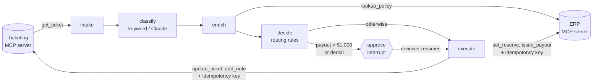

# AgenticWorkflowEngine

[](https://github.com/Jain-Karan/agentic-workflow-engine/actions/workflows/ci.yml)


A claims-intake agent modeled on an insurer's first-notice-of-loss queue. It reads each ticket,
classifies it, looks up the policy, decides what should happen, and does it through **MCP tool
servers** for the ERP and ticketing systems. **A human approves every payout above $1,000 and
every coverage denial** before anything is written.

The interesting part isn't the happy path. It's what happens when the APIs misbehave: rate
limits, 503s, and timeouts that arrive *after* the write already committed. That last case is
how naive retries pay a claim twice.

- **LangGraph workflow** with `interrupt()` approval gates, checkpointed per ticket. A paused
  ticket holds no resources, and resuming continues from the gate.
- **MCP v2 servers** (`MCPServer`) for policy lookup, reserves and payouts, and for ticket
  updates and notes. They run in-process for tests, and over stdio or HTTP in a deployment.
- **Tool gateway** with exponential backoff and full jitter. It honours `Retry-After`, retries
  only errors the server marks retryable, and sends an idempotency key on every
  non-idempotent write.
- **Routing rules in plain Python**, separate from the graph, so claims staff can review the
  business logic. Rules cover fast-track settlement, adjuster queues, SIU referral, and denials.
- **Classifiers:** an offline calibrated keyword model for CI, and Claude through
  LangChain structured output (`--classifier anthropic`, bring your own key).
- **A 2,000-ticket synthetic backlog** with ground truth, fault injection, and a CI gate on
  quality and safety.



## Quickstart

```bash
pip install -e ".[dev]"
claimflow demo -n 12                 # 12 synthetic tickets and what the agent did with each
claimflow bench -n 2000 --faults     # backlog benchmark with injected API failures
pytest
```

Classify with Claude instead of the offline model:

```bash
pip install -e ".[anthropic]"
export ANTHROPIC_API_KEY=...
claimflow demo --classifier anthropic
```

Run the MCP servers as real processes, for example for an MCP-aware client:

```bash
python -m claimflow.mcp_servers erp         # stdio
python -m claimflow.mcp_servers ticketing
```

## How a ticket flows

| step | what happens | tools |
|---|---|---|
| intake | fetch the ticket | `ticketing.get_ticket` |
| classify | category, confidence, reported amount | classifier |
| enrich | policy status, coverages, deductibles, prior claims, fraud watch | `erp.lookup_policy` |
| decide | `rules.decide()`: fast-track, adjuster, SIU, service reply, denial or hand back to a human | none |
| approve | **pauses** for payouts over $1,000 and for denials; the reviewer can approve, edit the amount or reject | `interrupt()` |
| execute | reserve, payout, ticket status and queue, audit note | `erp.set_reserve`, `erp.issue_payout`, `ticketing.update_ticket`, `ticketing.add_note` |

Confidence under 0.6, a missing policy, or a policy number that doesn't exist sends the
ticket to `intake-manual` rather than guessing.

## Benchmark

`python benchmarks/run_benchmark.py` runs 2,000 seeded synthetic tickets: auto, glass, water,
fire, theft and liability claims, billing and policy changes, plus 8% deliberately ambiguous
"hard cases". Every ticket carries a ground-truth category and the action the rules would take
on the true category and true policy. The simulated reviewer approves an action only if it
matches ground truth.

| metric | clean APIs | faulty APIs (5% 429, 3% 503, 2% timeout-after-commit) |
|---|---|---|
| category accuracy | 97.2% | 97.2% |
| action accuracy (before review) | 91.0% | 91.0% |
| automated, no human touch | 76.9% | 76.9% |
| sent for approval | 7.8% | 7.8% |
| handed back to a human | 15.3% | 15.3% |
| failed tickets | 0 | 0 |
| payout errors | 0 | 0 |
| **duplicate payments** | **0** | **0** |
| **duplicate ticket notes** | **0** | **0** |
| tool calls | 8,317 | 9,183 |
| retries | 0 | 866 |
| backoff time (virtual s) | 0.0 | 519.9 |
| human minutes, manual intake | 13,004 | 13,004 |
| human minutes, with agent | 2,022 | 2,022 |
| **intake handling time reduction** | **84.5%** | **84.5%** |

The fault-injection run is reproducible: the same seed gives the same retries, calls and
backoff at any concurrency. Backoff sleeps advance a virtual clock, so the benchmark takes
about 13 seconds on a 2-vCPU container while still exercising the real retry code.

### How handling time is modeled

Human time is **modeled, not measured**, using the assumptions in `bench.TimeModel`. Manual
intake per ticket costs 3 min to read and classify, 2.5 min for a policy lookup (claims with a
policy number), 1.5 min to route, and 4 min to settle a fast-track claim. With the agent,
humans spend 2 min per approval request, plus the full manual time on every ticket handed back.
Downstream adjuster and SIU work is identical either way and is excluded.

The result doesn't hinge on those numbers:

| assumption | reduction |
|---|---|
| as above | 84.5% |
| a review takes 5 min, not 2 | 80.9% |
| manual intake is twice as fast as assumed | 82.1% |
| both | 74.9% |

Hand-backs dominate the remaining human time, which is why classifier calibration (#3 below)
moved the number more than anything else.

### What the benchmark does *not* show

- **The tickets are synthetic and templated.** 97% category accuracy is what a keyword model
  gets on its own generator's vocabulary, not on real customer email. The calibration table is
  fitted on that same generator. Refit it with `fit_table()` on labelled history before
  trusting it on real traffic.
- **The Claude classifier isn't benchmarked here**, because CI runs offline. It plugs into the
  same `Classifier` interface, and `claimflow bench --classifier anthropic` measures it with
  your key.
- **The simulated reviewer knows the right answer**, so the approval step is never wrong. Real
  reviewers are, and that cost isn't modeled.

## How it got here

The first version was correct on clean APIs. Running the backlog with injected faults, and
reading the hand-backs, surfaced three problems. Each was fixed in its own pull request with a
regression test that fails before the change.

| # | problem found | fix | effect |
|---|---|---|---|
| 1 | 46 of 2,000 tickets got the same note twice: `add_note` timed out *after* committing, and the correct retry wrote it again. Payouts had an idempotency key; notes didn't. | idempotency keys on notes, sent by the agent; benchmark tracks duplicate notes | duplicate notes 46 → 0. The first attempt fixed only the server and the new metric still showed 36, which caught it. |
| 2 | The same seed gave 260, 256 and 222 retries on three runs: faults came from one shared RNG in arrival order, which changes with concurrency | fault and jitter decided by hash(seed, call, attempt) | identical results at concurrency 1 and 16 |
| 3 | 12.5% of tickets were classified **correctly** and still handed back: softmax confidence was under-confident (scores of 0.3–0.5 were right 100% of the time) | histogram-binning calibration fitted on a separate seed, with a conservative fallback for unseen states | hand-backs 21.1% → 15.3%, action accuracy 85.1% → 91.0%, confident-but-wrong held at 0 |

For #3, a logistic calibration was tried first and rejected: it cut hand-backs further but raised
confident-but-wrong from 0 to 1.7%. A wrong ticket processed automatically is worse than a right
one handed back.

CI fails if any safety property breaks (duplicate payments or notes, payout errors, failed
tickets) or quality drops below its floor (`tests/test_benchmark_gate.py`).

## Layout

```
src/claimflow/
  domain.py        tickets, categories, actions, decisions
  backends.py      simulated ERP + ticketing, deterministic fault injection
  mcp_servers.py   MCP v2 servers over both backends
  gateway.py       MCP client with retries, backoff, Retry-After
  classify.py      calibrated keyword classifier, LangChain/Claude classifier
  rules.py         routing rules (fast-track, adjuster, SIU, denial, hand-back)
  graph.py         LangGraph workflow with the approval interrupt
  runner.py        backlog runner that pauses and resumes at approval gates
  synthetic.py     seeded FNOL backlog with ground truth
  bench.py         metrics and the handling-time model
benchmarks/        run_benchmark.py, calibrate_classifier.py
tests/             rules, gateway (retries, idempotency), graph (HITL), calibration, CI gate
```

## Development

```bash
pip install -e ".[dev]"
ruff check . && ruff format --check .
pytest --cov=claimflow      # 90% coverage
```

Pushes to `main` are mirrored to GitLab by `.github/workflows/mirror-gitlab.yml`.

## License

MIT
